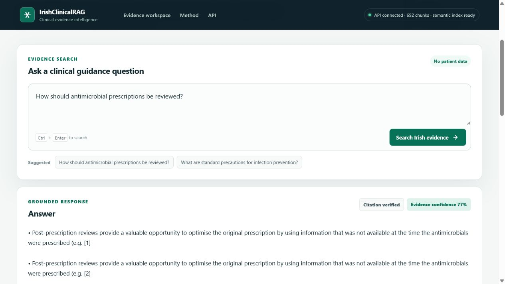
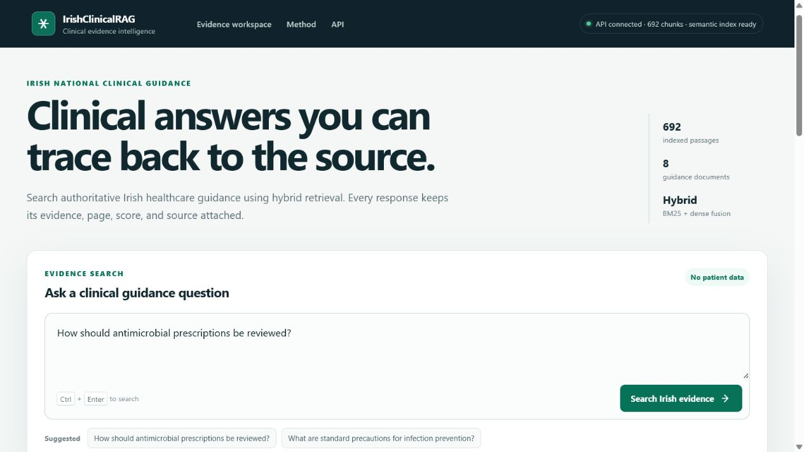
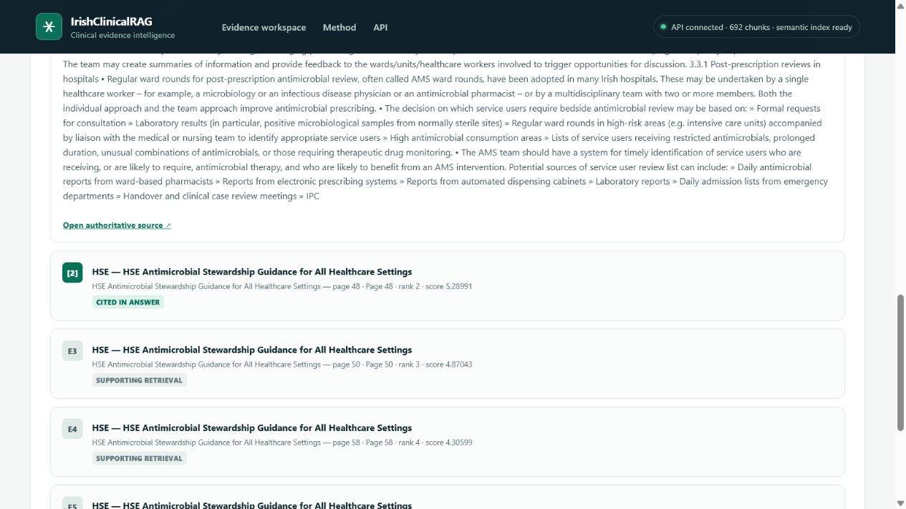
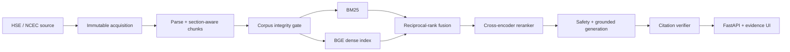

# IrishClinicalRAG

**Evidence-grounded clinical and biomedical research assistance for Irish healthcare guidance.**

Hybrid retrieval · Irish evidence provenance · Cross-encoder reranking · Citation
verification · Safety-aware RAG · FastAPI · Docker

> Research prototype for decision-support research and education. It is not a certified
> medical device, is not a replacement for clinical judgement, and must not receive
> patient-identifiable information. For an emergency in Ireland, call 112 or 999.



IrishClinicalRAG answers questions from a versioned collection of public HSE and NCEC
guidance. It keeps the organisation, document, date, URL, exact passage, page, retrieval
score, confidence, and limitations attached to the answer so the evidence can be audited.

| Release evidence | Measured value |
|---|---:|
| Public HSE/NCEC documents | 8 |
| Checksum-verified passages | 692 |
| Synthetic, non-patient evaluation cases | 100 |
| Retrieval predictions in the canonical experiment | 400 |
| Critical automated tests | 51 |

## Why this project exists

General-purpose chat systems can produce fluent medical text without making the supporting
evidence inspectable. This project asks a narrower question: can a reproducible,
retrieval-first system answer from authoritative Irish guidance and expose exactly what
supports the answer?

The seven-day research release implements the complete evidence path:

```text
official Irish source -> immutable download -> parse -> metadata-aware chunks
-> corpus validation -> BM25 + BGE vectors -> RRF fusion -> reranking
-> evidence sufficiency + generation -> citation verification -> API and web UI
```

## Demo

Run the API and evidence workspace locally, then open <http://localhost:8000>:

```bash
.venv/Scripts/uvicorn irishclinicalrag.api.app:app --host 127.0.0.1 --port 8000
```

Good synthetic demo questions include:

- `How should antimicrobial prescriptions be reviewed?`
- `What are standard precautions for infection prevention?`
- `What principles guide antimicrobial prescribing?`

The interface also demonstrates a deliberate abstention for an unsupported query and
urgent escalation for obvious emergency language. A public hosted demo is not currently
claimed; deployment is tracked in the [roadmap](docs/ROADMAP.md).

| Evidence workspace | Inspectable source provenance |
|---|---|
|  |  |

## Results

The canonical experiment uses 25 manually authored, source-checked questions and 75
deterministic lexical probes. Headline values below are only for the harder 25-question
reviewed cohort; latency is warm CPU query execution after one unmeasured warm-up.

| Retriever | Recall@5 | MRR | Median warm latency |
|---|---:|---:|---:|
| BM25 | 0.820 | 0.641 | 2.6 ms |
| Dense | 0.780 | 0.660 | 57.8 ms |
| Hybrid | 0.920 | 0.827 | 68.3 ms |
| Hybrid + reranker | 0.940 | 0.837 | 1,698.6 ms |

Hybrid retrieval improved reviewed Recall@5 by 0.10 absolute over the stronger individual
retriever. The cross-encoder added another 0.02, but raised median CPU latency by roughly
25 times relative to hybrid retrieval. All methods reached source-document Recall@5 of
1.000 on the reviewed cohort; remaining misses were exact-passage ranking failures.

The result supports an engineering conclusion about this small benchmark, not a claim of
clinical superiority. See the [full results and failure audit](docs/results/day4.md),
[evaluation protocol](docs/EVALUATION.md), and committed
[machine-readable metrics](experiments/results/day4/metrics.json).

## Data and provenance

The source catalog contains authoritative HSE/NCEC URLs rather than copied clinical
content. The current snapshot spans antimicrobial stewardship, COPD, urinary tract
infection, penicillin allergy, infection prevention, and national clinical-effectiveness
guidance.

Downloads are checksum-addressed under ignored `data/raw/` storage and recorded in an
append-only manifest. Generated source files, passages, vectors, and model files are not
committed. The committed [corpus lock](data/manifests/corpus-lock.json) records exact
checksums, byte counts, source metadata, passage counts, and corpus fingerprint needed to
reproduce the snapshot.

## Methodology

- **Ingestion:** download public sources without silent overwrite; record URL, timestamp,
  media type, byte count, and SHA-256.
- **Processing:** parse PDF/HTML, preserve page and document metadata, create overlapping
  section-aware chunks, then fail closed on corpus-integrity errors.
- **Retrieval:** evaluate BM25, BGE-small dense retrieval, reciprocal-rank fusion, and
  hybrid plus MS MARCO cross-encoder reranking independently.
- **Generation:** default to an offline extractive provider and require every substantive
  paragraph to cite a known retrieved chunk. An OpenAI-compatible provider is optional.
- **Safety:** bypass retrieval for obvious emergencies and abstain when evidence does not
  satisfy deterministic sufficiency thresholds.
- **Evaluation:** report reviewed questions separately from easier lexical probes; retain
  per-case predictions and exact experiment provenance.

The detailed design and reproducibility decisions are in
[docs/METHODOLOGY.md](docs/METHODOLOGY.md).

## Architecture



See the [full system and request-flow diagrams](docs/architecture/system.md).

## Installation

Python 3.11 or newer is required.

```bash
python -m venv .venv
.venv/Scripts/python -m pip install -e ".[dev,ml]"
irishclinicalrag ingest configs/sources.json
irishclinicalrag validate configs/sources.json
irishclinicalrag build-index
pytest
```

The ML models are downloaded on first use. Once cached, retrieval runs without Hugging
Face network access. Retrieval, reranking, safety, and the default generation path do not
need a hosted LLM or GPU.

### Docker Compose

```bash
docker compose up --build
```

First startup ingests public sources and builds the configured indexes, so it is slower
than later starts. A named volume preserves corpus/index state and the model cache. The
container runs as a non-root user with a read-only root filesystem, dropped capabilities,
bounded PIDs, a readiness health check, graceful shutdown, and optional model warming.

The production image has built successfully in GitHub Actions. The Windows workstation
used for the final release audit still requires its WSL 2 platform activation/restart
before a local Compose-runtime claim can be made; see
[Day 7 verification](docs/DAY7_VERIFICATION.md).

## API and generation providers

Required endpoints are `/health`, `/health/live`, `/query`, `/retrieve`, `/sources`, and
`/metrics`; interactive OpenAPI documentation is at `/docs`.

The safe default generator is offline and extractive. To use an OpenAI-compatible hosted,
local, or RunPod endpoint, configure `generation.provider`, `generation.model`, and
`generation.base_url`, then inject the credential at runtime only:

```cmd
set IRISHCLINICALRAG_LLM_API_KEY=your-runtime-secret
```

If the remote provider fails or returns unverifiable citations, the service exposes the
fallback reason and uses the auditable extractive answer. Never commit the credential.

## Reproducing the benchmark

```bash
irishclinicalrag build-eval
irishclinicalrag evaluate
```

Use `--method bm25`, `dense`, `hybrid`, or `hybrid-rerank` with the retrieval CLI to
inspect each path independently. The evaluation stores the dataset checksum, Git commit,
corpus fingerprint, model names, parameters, cohort counts, aggregate metrics, and all
per-case predictions. The Day 6 regression reran all 400 predictions and matched the
canonical rankings exactly.

## Safety, privacy, and observability

- Weak or missing evidence produces abstention, not confident medical advice.
- Obvious emergency language directs the user to urgent real-world help and skips
  retrieval.
- Only public documents and synthetic/demo questions belong in this repository.
- Raw questions, answers, and retrieved passages are excluded from logs and metrics.
- Operational events retain random request ID, lengths, method, public document IDs,
  scores, timing, provider/model identifiers, cache state, and safety outcome.
- `/metrics` contains in-memory aggregate engineering telemetry only.

This system has not been clinically validated and must not be used as an autonomous
diagnostic, prescribing, triage, or treatment system.

## Repository map

| Path | Purpose |
|---|---|
| `src/irishclinicalrag/` | Typed production ingestion, retrieval, generation, safety, evaluation, and API modules |
| `configs/` | Source catalog and runtime configuration |
| `data/manifests/` | Committed corpus lock and validation evidence |
| `data/eval/` | Synthetic/non-patient evaluation questions |
| `experiments/results/day4/` | Canonical metrics and all retrieval predictions |
| `frontend/` | Responsive evidence workspace |
| `tests/` | Critical regression and release-contract tests |
| `docs/` | Methodology, architecture, results, verification, status, and roadmap |

## Limitations

- The eight-document corpus is deliberately focused and does not represent all Irish
  clinical guidance.
- The 25 reviewed questions were source-checked but not independently assessed by
  clinicians for medical correctness, completeness, or safety.
- Exact-passage labels are sparse; an unlabelled retrieved passage may still be relevant.
- Grounded-answer scores are deterministic provenance checks, not clinical correctness
  ratings, and no LLM judge was used.
- CPU latency is workstation-specific. Reranking is substantially slower than hybrid
  retrieval and needs deployment-specific budgeting.
- There is no current public hosted demo or automated corpus-refresh job.

## Project status and roadmap

The seven-day core research release is implemented and measured. Screenshots, methodology,
architecture, final results, release checks, and portfolio notes are committed. Public
hosting and the final local Windows Compose acceptance check remain explicitly open.

- [Delivery status](docs/STATUS.md)
- [Day 7 release verification](docs/DAY7_VERIFICATION.md)
- [Prioritised roadmap and issue-ready acceptance criteria](docs/ROADMAP.md)
- [Portfolio narrative and CV bullets](docs/PORTFOLIO.md)

## Attribution

The implementation and product structure in this repository are independent. The initial
architecture was informed by an MIT-licensed medical-RAG project; no upstream code is
currently included. Clinical documents remain the property of their publishers. See
[ATTRIBUTION.md](ATTRIBUTION.md) for the transparent provenance statement.
