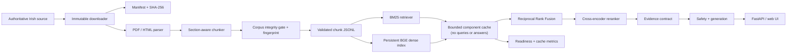
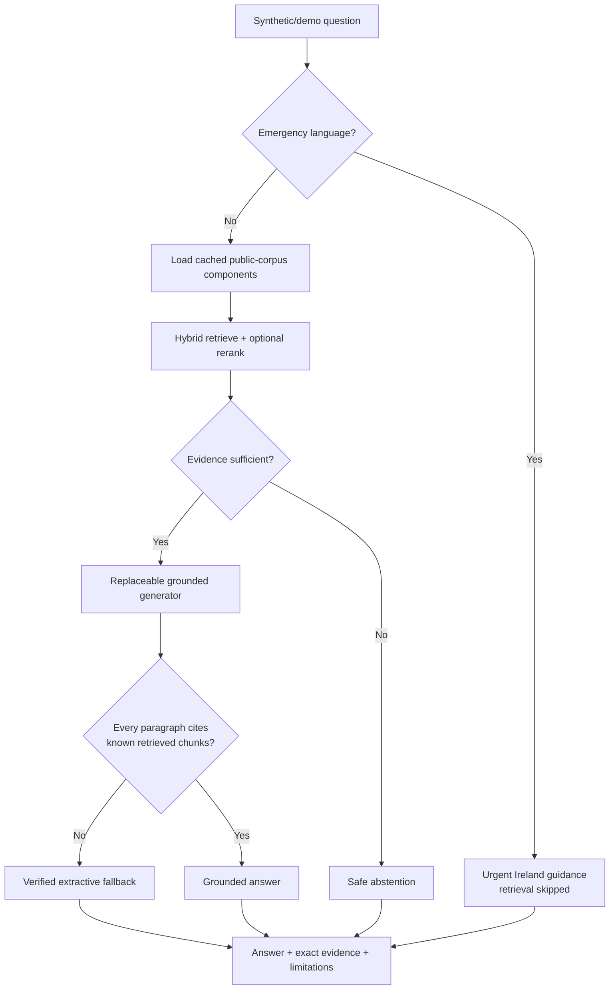

# System architecture

## Design boundaries

- Ingestion never silently overwrites raw material; blobs are addressed by checksum.
- Metadata is part of the chunk model and is returned with every retrieval result.
- Sparse and dense retrieval can be evaluated independently.
- Fusion consumes ranks, avoiding invalid comparison of unrelated score scales.
- The semantic index is bound to the corpus fingerprint and exact chunk order.
- Model-backed embeddings, rerankers, and generation providers are replaceable.
- Retrieval-only operation requires no external LLM and remains testable offline.
- The API reuses one public-data retrieval snapshot and invalidates it when source files
  change; it never caches raw questions or generated answers.
- Liveness is independent of readiness, while the readiness gate validates the corpus and
  retrieval runtime before the service accepts traffic.

## Request and safety flow

Only public component state is cached. Questions, answers, and retrieved passage payloads
are excluded from the cache, structured logs, and aggregate metrics.
